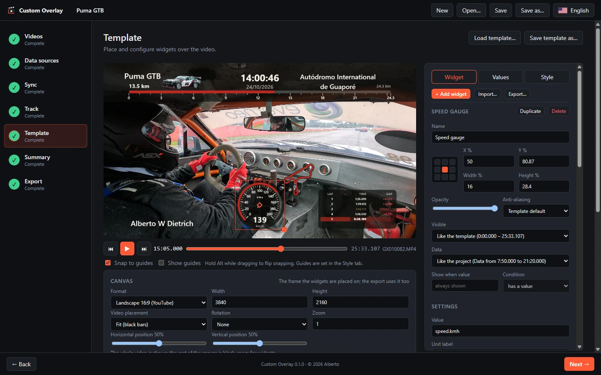
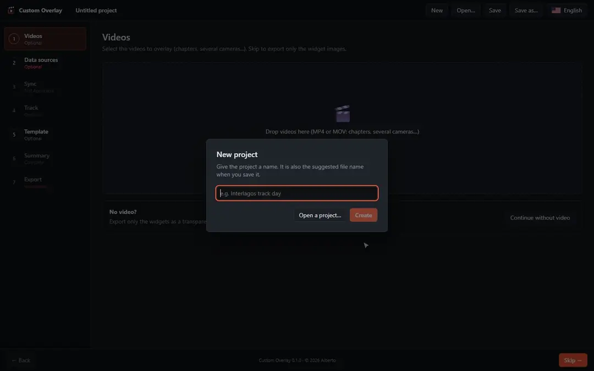
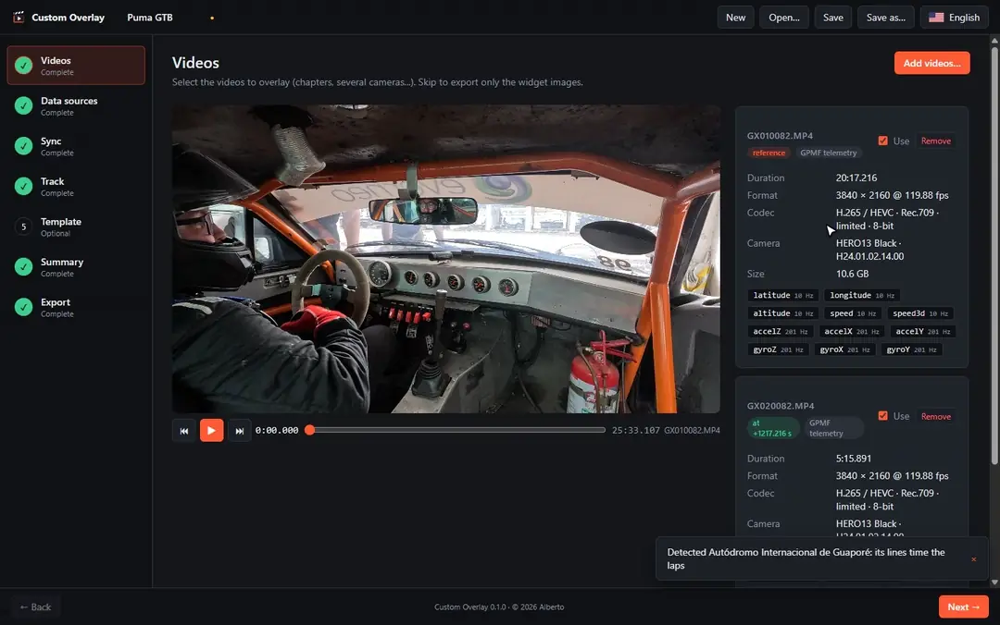
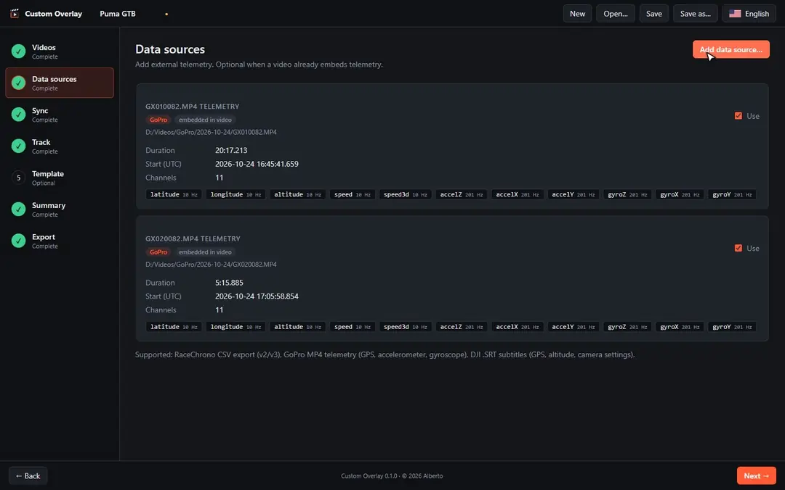
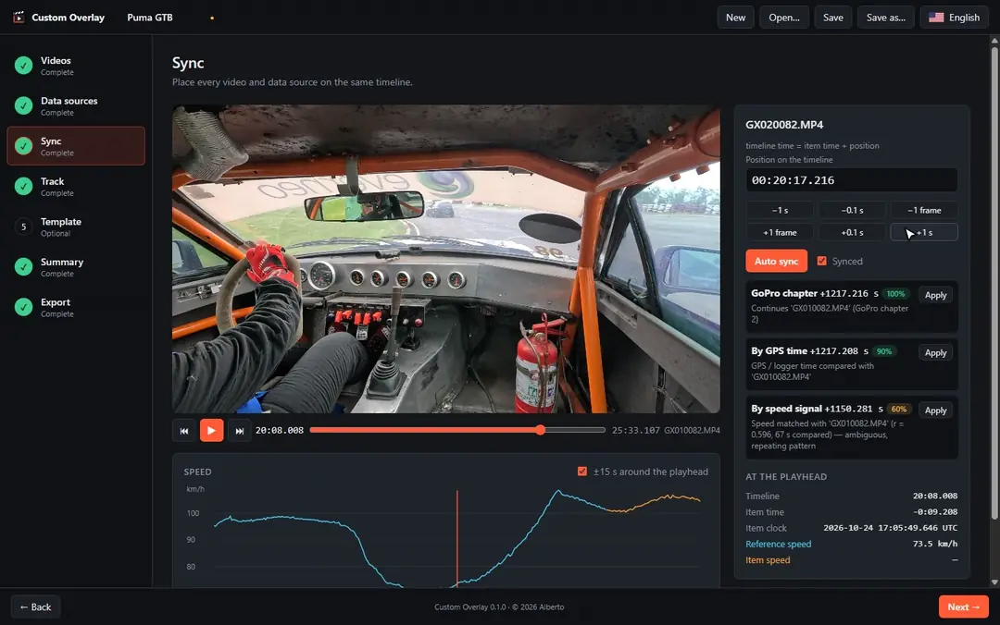
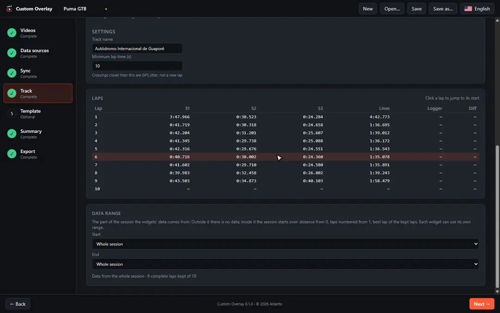
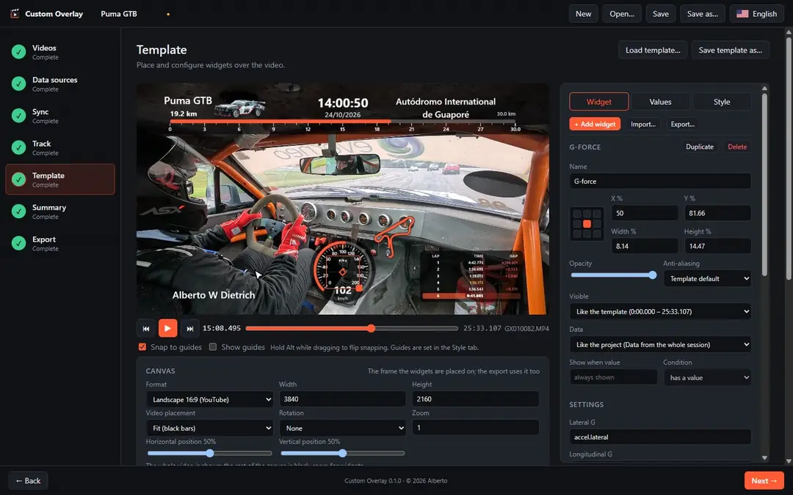
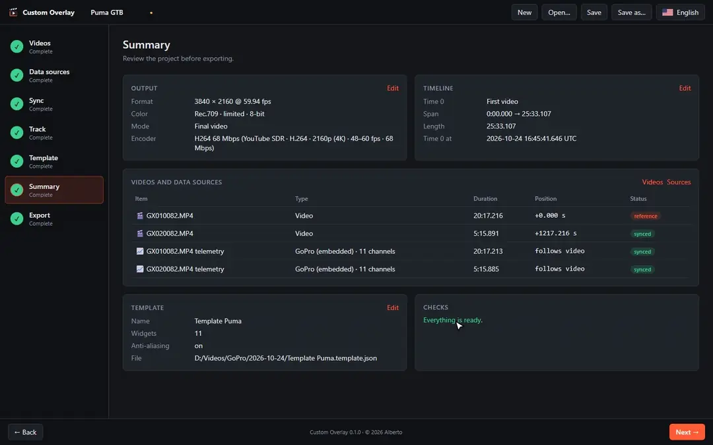

# Custom Overlay

Put your telemetry on your onboard videos. Custom Overlay syncs videos from any camera with the
data recorded by the camera itself (GoPro, DJI) or by a lap timer such as RaceChrono, lets you
design overlay widgets on top of the video (speed, G-force, track map, lap times…), and exports
the final video or a transparent image sequence with only the widgets.

**🌐 Website: [custom-overlay.albertowd.dev](https://custom-overlay.albertowd.dev)** ·
[Download](https://github.com/albertowd/custom-overlay/releases/latest) ·
[Discussions](https://github.com/albertowd/custom-overlay/discussions)



- **Any camera, any logger.** GoPro telemetry (GPS, accelerometer, gyroscope) is read straight
  from the video; DJI `.SRT` subtitles and RaceChrono CSV exports are supported too.
- **Automatic sync.** Chapters, several cameras and the logger are placed on one timeline by
  GPS time and speed matching. You only review.
- **Lap timing from GPS.** Known tracks are detected from the GPS path; draw your own
  start/finish and sector lines anywhere else.
- **Sixteen widgets**, your own value scripts, reusable templates.
- **Fast export** on the GPU, with YouTube, TikTok and Instagram presets, up to 8K and HDR.
- Windows, macOS and Linux, plus a web app. In English, Português (Brasil), Español, Italiano
  and 日本語.

## Download

Get the latest version from the
[releases page](https://github.com/albertowd/custom-overlay/releases/latest):

| System                          | Installer   | Portable (no install) |
| ------------------------------- | ----------- | --------------------- |
| Windows x64                     | `.exe`      | `.zip`                |
| macOS (Apple Silicon and Intel) | `.dmg`      | `.zip`                |
| Linux x64                       | `.AppImage` | `.tar.gz`             |

The builds are not code-signed yet, so Windows SmartScreen ("Windows protected your PC" → _More
info_ → _Run anyway_) and macOS Gatekeeper (right-click the app → _Open_) warn on the first launch.
Each release lists the `SHA256SUMS.txt` of its files.

When a newer version is out, the app offers to download it at start: now, later, or never for
that version.

### Web app

The web app runs in the browser and can be installed as an app (PWA). It edits projects like the
desktop app, with files picked or dropped into the page, and exports the transparent PNG sequence:
into a folder in Chrome and Edge, as a zip download in other browsers. The final video is exported
by the desktop app: save the project next to its videos and open it there.

## How it works

The app walks you through seven steps. The left bar shows where you are and what is left; optional
steps can be skipped.

### 1. Videos

Drop your MP4 / MOV videos: chapters, several cameras… Adding one GoPro chapter offers to add the
other chapters of the same recording. The first video is the reference of the timeline and sets
the output format. Its telemetry (GoPro data inside the file, or the DJI `.SRT` next to it) is
added as a data source that follows the video.

No video? Skip this step to export only the widgets, as a transparent image sequence, to overlay
in your video editor.



### 2. Data sources

Add RaceChrono CSV exports (v2 / v3), DJI `.SRT` subtitles, or videos used only for their
telemetry. Optional when the video already has telemetry.



### 3. Sync

Every video and data source is placed on the timeline **automatically** when it loads:

- GoPro chapters are chained end to end;
- GPS time is compared between cameras and loggers;
- the speed curves are matched against each other;
- without GPS, the camera clock is used (with your timezone, since cameras often store local time).

Results the app is sure about are marked as synced; anything else is left for you to review. Play
the video and look at the speed chart, nudge by a frame, 0.1 s or 1 s, or pick another candidate.



### 4. Track

Optional: time laps and sectors from the GPS path.

- Known tracks are detected from the GPS path and their lines load on their own, or pick one from
  the list of nearby tracks or a search ([track list](packages/core/src/tracks/README.md)).
- Anywhere else, draw the start/finish line (or place it where the logger's lap changes) and the
  sector lines on the map. Lines import / export as `*.track.json`.
- Compare the laps timed by the lines with the logger's, and choose where lap values come from.
- Trim the data, e.g. from lap 2 without the last 2 laps: distance, laps and best laps start over
  inside it.



### 5. Template

Place widgets over the video and see them live as you play or scrub it. Widgets are placed by an
anchor (corner, edge or centre) and snap to guides.

- **Widget** tab: the selected widget's settings, its own time range, test values.
- **Values** tab: every value available to widgets, plus your own scripts.
- **Style** tab: font, anti-aliasing, colour palette, snap guides.
- **Canvas**: the output shape, e.g. 16:9 for YouTube or 9:16 for TikTok and Instagram, and how
  the video fits in it.

Load and save templates to reuse your overlay on every session. This step is always available,
even without data.



### 6. Summary

Output format, timeline, every video and data source with its position, the template, and
anything that still needs your attention.



### 7. Export

Choose what to export:

- the **final video**, with the widgets burned in;
- a **transparent PNG sequence** with only the widgets, to composite in your editor.

Set the range with the player (drag the handles, type the times, or press I / O at the playhead),
then the resolution, frame rate and colour, the encoder preset, and the scaling. The export runs
with live progress, and you can keep working meanwhile.



## Widgets

Sixteen built-in widgets: speed gauge, G-force circle, GPS path, live map (follow or whole track,
heading-up, marker image), distance bar (ticks by distance or by lap), elevation with profile, lap
timer, lap count, lap times table, date and time, timespan (countdown / elapsed), value text,
static text, image, dynamic image (rotated / moved / scaled by values), and shapes for
backgrounds.

Each widget has its own settings, a show/hide condition, palette colours and anti-aliasing. Widgets
and templates import / export as `*.widget.json` / `*.template.json`, to share them or reuse them.
See the [widgets guide](packages/core/src/widgets/README.md).

## Values

Widgets display **values**, one number per frame. They come from three places:

- every data source channel: `speed`, `gopro.speed`, `dji.altitude`, `racechrono.lateralAcc`…
- built-ins: `lap.time`, `lap.best`, `lap.remaining`, `session.remaining`, `speed.kmh`…
- your own JavaScript value scripts, each with an id, name, description, unit and initial value.

Scripts live in the project or in a template, and can be exported / imported as `*.values.json`
collections. See the [values guide](packages/core/src/values/README.md).

## Exporting

- **Speed.** Videos are decoded on the GPU (Windows and macOS) and encoded with NVIDIA, AMD or
  Intel GPU encoders when available, else on the CPU. A 4K 120 fps GoPro clip exported at 1080p60 renders at about 20–23 fps on a
  16-core machine with an AMD GPU.
- **Presets.** _YouTube SDR · H.264_ follows YouTube's recommended upload settings; _YouTube SDR ·
  HEVC_ is the same in H.265, so 10-bit footage still encodes on the GPU; _YouTube HDR · HEVC_ and
  _YouTube HDR · AV1_ are for 10-bit Rec.2020 HLG / PQ output. There is one preset per resolution
  (360p to 8K) and frame rate, plus TikTok / Instagram, "High quality archive" and "Editing
  friendly". Choosing a preset moves the output to its resolution and frame rate; any edit
  switches to "Custom". The export step warns when the output does not suit the preset, and
  estimates the file size.
- **Range.** Without a start or end, the export covers the data range set in the Track step,
  else the whole timeline.
- **Scaling.** Bilinear, bicubic, Lanczos, or "FSR 1 style" (Lanczos then sharpening) when the
  output size differs from the video.
- **Audio.** AAC, or copied untouched when the range is one uncut piece of one video.

The last used export settings are saved in the project.

## Files

- **Project** (`*.overlay.json`): videos and data sources with their positions on the timeline,
  output format, colour palette, track lines, export settings, and the template (inline or a link
  to a template file). Paths are stored relative to the project file, so a project can be moved
  together with its media.
- **Template** (`*.template.json`): widgets only. It is independent of any video, so the same
  template can be applied to many sessions.
- **Widget** (`*.widget.json`), **values** (`*.values.json`) and **track lines**
  (`*.track.json`): to share single pieces.

## Command line

Projects and templates made in the app can be rendered without a UI by the `custom-overlay`
command line, e.g. to export many sessions with the same template. It is not part of the
downloads yet: build it from source as described in [CONTRIBUTING.md](CONTRIBUTING.md), then:

```sh
custom-overlay probe GX010042.MP4             # video info, camera clock, embedded telemetry channels
custom-overlay source session.csv             # channels of a data source
custom-overlay sync GX010042.MP4 GX020042.MP4 session.csv  # candidate positions, best first
custom-overlay project init day.overlay.json --video GX010042.MP4 GX020042.MP4 --source session.csv
custom-overlay project status day.overlay.json
custom-overlay project sync day.overlay.json [--force] [--camera-tz -180]
custom-overlay template laps.template.json --name "Lap timer"
custom-overlay values list day.overlay.json --at 125.5       # every value at a timeline time
custom-overlay values import day.overlay.json race.values.json
custom-overlay values export day.overlay.json race.values.json
custom-overlay export day.overlay.json [-o race.mp4] [--start 1:30 --end 4:00] [--software]
```

Most commands accept `--json`.

## Languages

The app is available in English, Português (Brasil), Español, Italiano and 日本語. It follows the
system language on the first start; the language menu in the toolbar changes it at any time.
Translation fixes are welcome: see [CONTRIBUTING.md](CONTRIBUTING.md#translations).

## Troubleshooting

- **Black video or decode error with H.265 (HEVC) footage**: the app decodes HEVC only with
  hardware support. Telemetry loading and sync still work, and so does the export.
- **"Windows protected your PC" / "app can't be opened"**: the builds are not code-signed yet, see
  [Download](#download).

## Community and support

- **Bugs and feature requests:** [GitHub Issues](https://github.com/albertowd/custom-overlay/issues).
- **Questions, ideas, and sharing widgets, templates, value scripts and tracks:**
  [GitHub Discussions](https://github.com/albertowd/custom-overlay/discussions).
- **Tracks:** the [list of known tracks](packages/core/src/tracks/README.md) is updated from GitHub
  at every start, and anyone can extend or fix it: fill in the
  [Add or fix a track](https://github.com/albertowd/custom-overlay/issues/new?template=track.yml)
  form with the `*.track.json` exported from the Track step.
- **Contributing code or translations:** [CONTRIBUTING.md](CONTRIBUTING.md).

## Roadmap

- Scripted widgets (render code written in the editor, like value scripts) and 3D widgets
- More built-in widgets (lap list, delta bar, shift lights…) and data sources (TCX, GPX…)

## License

Custom Overlay is licensed under the [GNU Affero General Public License v3.0](LICENSE)
(`AGPL-3.0-only`). You may use, study, modify and share it. If you distribute a modified version,
or let others use one over a network, you must publish its full source under the same license.

Widgets, templates, value scripts and tracks shared in Discussions, track issues and track pull
requests are released to the public domain under
[CC0 1.0](https://creativecommons.org/publicdomain/zero/1.0/), so anyone can reuse them and they can
be bundled with the app.
